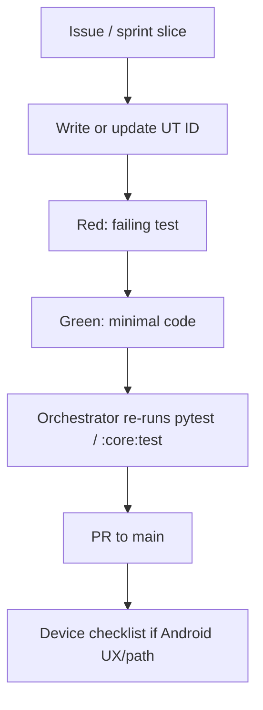

# Contributing to ElderShield

Thanks for helping protect parents’ devices. This project prioritizes **safe banking-app compatibility**, **silent parent UX**, and **TDD with local re-measurement**.

<p align="center">
  <a href="README.md">README (EN)</a> · <a href="README.ko.md">README (KO)</a> · <a href="SECURITY.md">Security</a> · <a href="AGENTS.md">AGENTS.md</a>
</p>

---

## Ground rules

| Rule | Why |
|------|-----|
| No auto-commit / no force-push to `main` | Human review gate |
| Design SSOT first | Do not silently change contracts — edit [`docs/specs/`](docs/specs/) then code |
| Backend before Android for new contracts | Keep `RuleBundle` JSON stable |
| Unit tests before merge for matching / version / auth | Catch regressions before device work |
| Hard constraints | No Overlay / Accessibility / Device Admin; `VpnService` off by default |

Agent roles (Grok implementer / Composer orchestrator): see [`AGENTS.md`](AGENTS.md).

---

## Development workflow



1. Branch from `main` (e.g. `fix/...`, `feat/...`).  
2. Prefer small PRs aligned to sprint board slices.  
3. Update **Status** cells in [`docs/plans/2026-11-19-sprint-board.md`](docs/plans/2026-11-19-sprint-board.md) only — avoid doc bloat.  
4. Open a PR; do not merge your own critical/security changes without review.

---

## Local setup

### Backend

| Step | Command / note |
|------|----------------|
| Venv | `cd backend && python -m venv .venv && pip install -r requirements.txt` |
| Env | Copy `.env.example` → `.env`; set **distinct** non-`change-me` keys |
| Run | `uvicorn app.main:app --reload --host 0.0.0.0 --port 8000` |
| Test | `pytest -q` |

### Android

| Step | Command / note |
|------|----------------|
| SDK | `android/local.properties` → `sdk.dir=...` |
| Domain tests | `./gradlew :core:test` (JDK 17+, 21 recommended) |
| Debug APK | `./gradlew :app:assembleDebug` |
| Device | Follow [`docs/runbooks/device-test.md`](docs/runbooks/device-test.md) |

---

## Coding standards

| Area | Expectation |
|------|-------------|
| API | `/api/v1`, camelCase JSON aliases, device vs admin keys |
| `countries` | Always a JSON **array** |
| RuleBundle `version` | Monotonic **generation** via `RuleBundleMeta` |
| Android packages | `com.eldershield/{data,domain,service,scanner,ui}` |
| Parent UX | No status/alerts on the parent path; admin MainActivity is installer-only |
| Secrets | Never commit `.env`, keys, or production DB files |

---

## Pull requests

Please include:

```markdown
## Summary
- …

## Test plan
- [ ] `cd backend && pytest -q`
- [ ] `cd android && ./gradlew :core:test`
- [ ] (if Android UI/path) assembleDebug + device-test notes
```

Link related UT IDs (`UT-A-*` / `UT-B-*`) when touching matching, sync, or API auth.

---

## License

By contributing, you agree that your contributions are licensed under the Apache License 2.0 ([`LICENSE`](LICENSE)).
