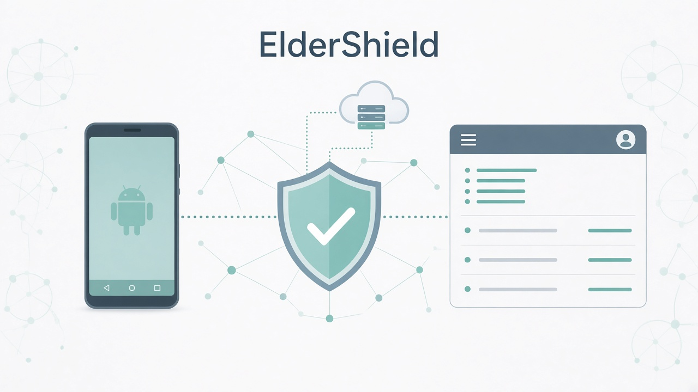
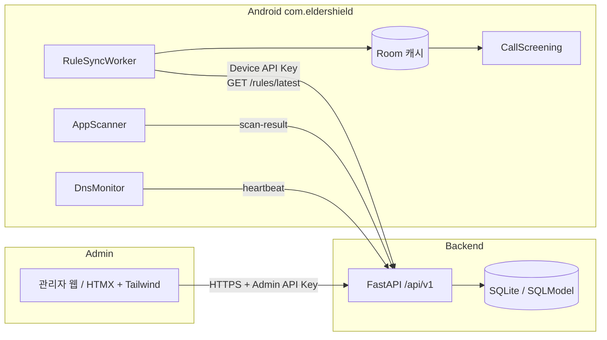
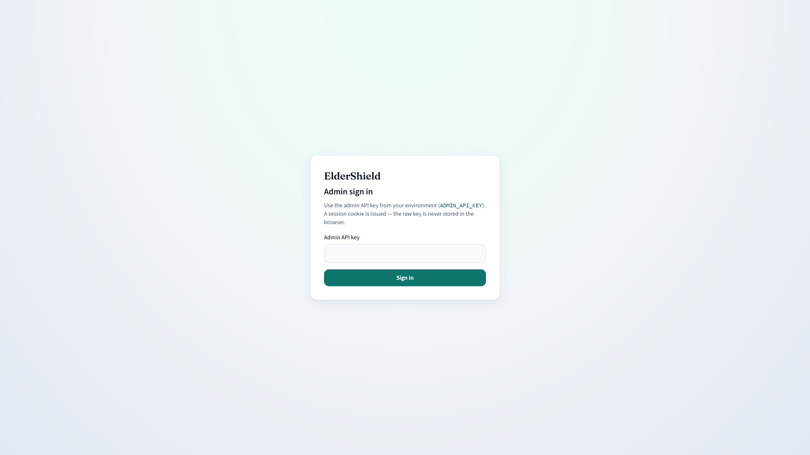

# ElderShield (실버실드)

<p align="center">
  
</p>

<p align="center">
  <strong>부모님 Android 기기용 방어적 Guard</strong><br/>
  위험 국가 전화 차단 · Private DNS 상태 · 사기앱 탐지 · 관리자 전용 제어
</p>

<p align="center">
  <a href="LICENSE"></a>
  
  
  
  
</p>

<p align="center">
  <a href="README.md">English</a> · <a href="README.ko.md">한국어</a>
  · <a href="CONTRIBUTING.md">Contributing</a>
  · <a href="SECURITY.md">Security</a>
  · <a href="docs/README.md">문서</a>
</p>

---

## 개요

| | |
|---|---|
| **제품** | ElderShield(실버실드) — 부모님 폰/태블릿용 **무인지** 방어 계층 |
| **조작 주체** | **관리자만** (웹 + API). 부모님은 설치·권한 후 추가 조작 없음 |
| **Phase 1** | 전화 스크리닝 · Private DNS 상태 · 앱 위험 스캔 보고 · 버전 규칙 동기화 |
| **Phase 2** | 기기 health · 오버레이/접근성 **가능 앱**(P3) · threat DNS · audit/notify/`/health` |
| **비범위** | 기본 `VpnService`, ElderShield Overlay/Accessibility/Device Admin, 역공격, 다조직(B) |

| 기능 | 방식 |
|------|------|
| 위험 국가 **전화** | `CallScreeningService` + Room 캐시 `RuleBundle` (+ `CallRule` 화이트리스트); `role_lost`는 관리자 경보만 |
| 위험 국가 **인터넷** | Private DNS(NextDNS/AdGuard) + Admin **DNS denylist** + threat-host. 앱 VPN 없음 |
| **사기/사이드로드 앱** | 스캔·오버레이 가능 신호 포함 **관리자 보고만** (부모 팝업 없음) |
| **제어면** | 관리자 웹 + `X-API-Key` API + 단조 **generation** + audit |

> 일반 백신 제품을 **대체하지 않고** 보완합니다.

---

## 아키텍처



| 계층 | 스택 |
|------|------|
| Backend | FastAPI · SQLModel · pytest · 관리자 UI(**HTMX + Tailwind CDN**) |
| Android | Kotlin · minSdk 29 · `:core`(JVM 도메인) · `:app`(Room/WorkManager/CallScreening) |
| 인증 | **기기** / **관리자** `X-API-Key` 분리 (`change-me-*` 기동 거부) |

**RuleBundle `version`** = 단조 **generation**(생성/수정/삭제/롤백 시 증가).  
개별 행 `version`의 `max`가 **아닙니다**.

---

## 하드 제약

| 규칙 | 내용 |
|------|------|
| 부모님 불편 제로 | 무인지 규칙 갱신 · 부모용 알림 금지 |
| 은행 앱 호환 | `VpnService` **기본 비활성** · Overlay/Accessibility/Device Admin **금지** |
| 합법적 방어만 | 역공격·원격 강제 삭제 없음 |
| 다중 국가 | `countries`는 항상 **배열** |

설계 SSOT: [`docs/specs/2026-11-18-eldershield-system-design.md`](docs/specs/2026-11-18-eldershield-system-design.md)

---

## 관리자 콘솔

<p align="center">
  
</p>

엔터프라이즈형 콘솔: 다크 사이드바 · 패널 카드 · 상태 배지 — **Tailwind CSS CDN** + HTMX.  
상세: [`docs/runbooks/admin-ui.md`](docs/runbooks/admin-ui.md)

## 빠른 시작

### Backend

```bash
cd backend
python -m venv .venv
# Windows: .venv\Scripts\activate
pip install -r requirements.txt
copy .env.example .env   # ADMIN_API_KEY / DEVICE_API_KEY 서로 다르게 설정
uvicorn app.main:app --reload --host 0.0.0.0 --port 8000
```

| URL | 용도 |
|-----|------|
| `http://<host>:8000/admin/ui/login` | 관리자 UI — Tailwind 콘솔 (HMAC 세션 · 키 원문 아님). [`docs/runbooks/admin-ui.md`](docs/runbooks/admin-ui.md) |
| `http://<host>:8000/api/v1/...` | 기기·관리자 JSON API |
| `http://<host>:8000/health` | 헬스체크 |

로컬 예외만: `ELDERSHIELD_ALLOW_INSECURE_DEFAULTS=1`  
HTTPS 쿠키: `COOKIE_SECURE=1`  
운영: [`docs/runbooks/admin-api-keys.md`](docs/runbooks/admin-api-keys.md) · [`docs/runbooks/rollback.md`](docs/runbooks/rollback.md)

### Android (debug)

```bash
cd android
# local.properties → sdk.dir=...
./gradlew :app:assembleDebug
adb install -r app/build/outputs/apk/debug/app-debug.apk
```

1. 앱 실행 → **Base URL**(오리진만, 예: `http://192.168.0.10:8000`) + **Device API key** → **Save & sync now**  
2. **Request call screening role** (또는 `adb shell cmd role add-role-holder android.app.role.CALL_SCREENING com.eldershield`)  
3. Admin UI에서 `applyTo`에 `call`이 포함된 CountryRestriction 생성  
4. `GET /api/v1/admin/devices`에 heartbeat 확인  

전체 체크리스트: [`docs/runbooks/device-test.md`](docs/runbooks/device-test.md)

> Debug 빌드만 LAN용 cleartext HTTP 허용. **Release는 cleartext 비활성.**

---

## 검증 (자동화)

| 스위트 | 명령 | 기대 |
|--------|------|------|
| Backend | `cd backend && pytest -q` | 전부 통과 |
| Android 도메인 | `cd android && ./gradlew :core:test` | 전부 통과 |
| APK | `cd android && ./gradlew :app:assembleDebug` | BUILD SUCCESSFUL |

단위 테스트 ID: [`docs/specs/2026-11-19-unit-test-design.md`](docs/specs/2026-11-19-unit-test-design.md) · 스프린트 보드: [`docs/plans/2026-11-19-sprint-board.md`](docs/plans/2026-11-19-sprint-board.md)

---

## 문서 맵

| 경로 | 역할 |
|------|------|
| [`docs/README.md`](docs/README.md) | 문서 인덱스 |
| [`docs/specs/`](docs/specs/) | 설계 SSOT · 단위 테스트 설계 |
| [`docs/plans/`](docs/plans/) | 일정 · 스프린트 보드 |
| [`docs/runbooks/`](docs/runbooks/) | 롤백 · API 키 · **실기기 테스트** |
| [`AGENTS.md`](AGENTS.md) | 에이전트 작업 규칙 |
| [`backend/README.md`](backend/README.md) | Backend 설정 |
| [`android/README.md`](android/README.md) | Android 모듈 |

---

## 상태 · 알려진 갭

| 영역 | 상태 |
|------|------|
| S0–S5 | 구현됨 (backend + Android core 경로) |
| S6.1 | 실기기 체크리스트 — 런북 참고 |
| S6.2 | 롤백 API·런북 완료 · Play 내부 트랙 미착수 |
| Alembic | `versions/` 비어 있음 — 개발은 `create_all` |
| `appRiskRules` | 번들 필드 예약 · 점수는 당분간 로컬 |

---

## 라이선스

**Apache License, Version 2.0**. [`LICENSE`](LICENSE) 참고.

```text
Copyright 2026 xzawed
```
