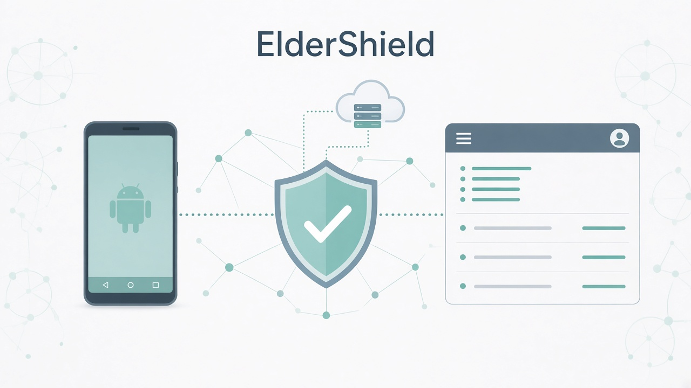
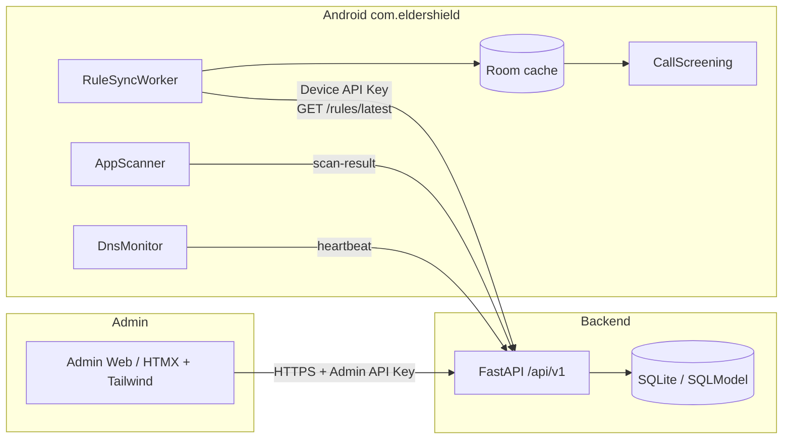
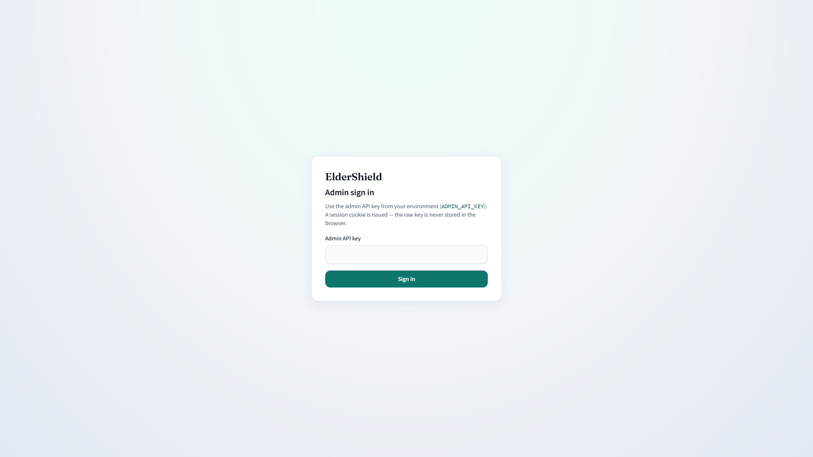

# ElderShield

<p align="center">
  
</p>

<p align="center">
  <strong>Defensive guard for parents’ Android devices</strong><br/>
  Block high-risk country calls · Monitor Private DNS · Detect suspicious apps · Admin-only control
</p>

<p align="center">
  <a href="LICENSE"></a>
  
  
  
  
</p>

<p align="center">
  <a href="README.md">English</a> · <a href="README.ko.md">한국어</a>
  · <a href="CONTRIBUTING.md">Contributing</a>
  · <a href="SECURITY.md">Security</a>
  · <a href="docs/README.md">Docs</a>
</p>

---

## Overview

| | |
|---|---|
| **Product** | ElderShield (실버실드) — hands-off defensive layer for parents’ phones/tablets |
| **Who acts** | **Admin only** (web + API). Parents install once, grant roles/permissions, then do nothing |
| **Phase 1** | Call screening · Private DNS status · App risk scan report · Versioned rule sync |
| **Phase 2** | Device health · overlay/a11y **capability** scan (P3) · threat-host DNS · audit/notify/`/health` |
| **Out of scope** | Default `VpnService`, ElderShield Overlay/Accessibility/Device Admin, counter-attacks, multi-tenant (B) |

| Capability | How it works |
|------------|----------------|
| Risky-country **calls** | `CallScreeningService` + Room-cached `RuleBundle` (+ `CallRule` whitelist); `role_lost` admin alert only |
| Risky-country **internet** | Private DNS (NextDNS / AdGuard) + Admin **DNS denylist** + threat-host feed; no on-device VPN |
| **Scam / sideloaded apps** | Scan & report (incl. overlay capability reasons) to admin only |
| **Control plane** | Admin web + `X-API-Key` APIs + monotonic rule **generation** + audit log |

> Complements (does not replace) consumer antivirus products.

---

## Architecture



| Layer | Stack |
|-------|--------|
| Backend | FastAPI · SQLModel · pytest · Admin UI (**HTMX + Tailwind CDN**) |
| Android | Kotlin · minSdk 29 · `:core` (JVM domain) · `:app` (Room / WorkManager / CallScreening) |
| Auth | Separate **device** vs **admin** `X-API-Key` (startup refuses `change-me-*`) |

**RuleBundle `version`** = monotonic **generation** (increments on create/update/delete/rollback). It is **not** `max(row.version)`.

---

## Hard constraints

| Rule | Detail |
|------|--------|
| Zero parent friction | Silent rule updates; no parent-facing alerts |
| Banking-app safe | `VpnService` **off** by default; **no** Overlay / Accessibility / Device Admin |
| Defense only | No counter-attacks, no forced remote wipes |
| Multi-country | `countries` is always an **array** |

Design SSOT: [`docs/specs/2026-11-18-eldershield-system-design.md`](docs/specs/2026-11-18-eldershield-system-design.md)

---

## Admin console

<p align="center">
  
</p>

Enterprise-style console: dark sidebar, panel cards, status badges — **Tailwind CSS CDN** + HTMX.  
Details: [`docs/runbooks/admin-ui.md`](docs/runbooks/admin-ui.md)

## Quick start

### Backend

```bash
cd backend
python -m venv .venv
# Windows: .venv\Scripts\activate
pip install -r requirements.txt
copy .env.example .env   # set distinct ADMIN_API_KEY + DEVICE_API_KEY
uvicorn app.main:app --reload --host 0.0.0.0 --port 8000
```

| URL | Purpose |
|-----|---------|
| `http://<host>:8000/admin/ui/login` | Admin UI — Tailwind console (HMAC session; not raw key). See [`docs/runbooks/admin-ui.md`](docs/runbooks/admin-ui.md) |
| `http://<host>:8000/api/v1/...` | Device + admin JSON APIs |
| `http://<host>:8000/health` | Liveness |

Local escape hatch only: `ELDERSHIELD_ALLOW_INSECURE_DEFAULTS=1`  
HTTPS cookie flag: `COOKIE_SECURE=1`  
Ops notes: [`docs/runbooks/admin-api-keys.md`](docs/runbooks/admin-api-keys.md) · [`docs/runbooks/rollback.md`](docs/runbooks/rollback.md)

### Android (debug)

```bash
cd android
# local.properties → sdk.dir=...
./gradlew :app:assembleDebug
adb install -r app/build/outputs/apk/debug/app-debug.apk
```

1. Open app → enter **Base URL** (origin only, e.g. `http://192.168.0.10:8000`) + **Device API key** → **Save & sync now**  
2. **Request call screening role** (or `adb shell cmd role add-role-holder android.app.role.CALL_SCREENING com.eldershield`)  
3. Create a CountryRestriction with `applyTo` including `call` in Admin UI  
4. Confirm `GET /api/v1/admin/devices` shows heartbeat  

Full checklist: [`docs/runbooks/device-test.md`](docs/runbooks/device-test.md)

> Debug builds allow cleartext HTTP for LAN. **Release keeps cleartext off.**

---

## Verification (automated)

| Suite | Command | Expect |
|-------|---------|--------|
| Backend | `cd backend && pytest -q` | All green |
| Android domain | `cd android && ./gradlew :core:test` | All green |
| APK | `cd android && ./gradlew :app:assembleDebug` | BUILD SUCCESSFUL |

Unit-test IDs: [`docs/specs/2026-11-19-unit-test-design.md`](docs/specs/2026-11-19-unit-test-design.md) · Sprint board: [`docs/plans/2026-11-19-sprint-board.md`](docs/plans/2026-11-19-sprint-board.md)

---

## Documentation map

| Path | Role |
|------|------|
| [`docs/README.md`](docs/README.md) | Doc index |
| [`docs/specs/`](docs/specs/) | Design SSOT & unit-test design |
| [`docs/plans/`](docs/plans/) | Schedule / sprint board |
| [`docs/runbooks/`](docs/runbooks/) | Rollback, API keys, **device test** |
| [`AGENTS.md`](AGENTS.md) | Agent working rules |
| [`backend/README.md`](backend/README.md) | Backend setup |
| [`android/README.md`](android/README.md) | Android modules |

---

## Status & known gaps

| Area | State |
|------|--------|
| S0–S5 | Implemented (backend + Android core paths) |
| S6.1 | Real-device checklist — see runbook |
| S6.2 | Rollback API + runbook done; Play internal track pending |
| Alembic | `versions/` empty — schema via `create_all` (dev) |
| `appRiskRules` | Bundle field reserved; scoring is local for now |

---

## License

Licensed under the **Apache License, Version 2.0**. See [`LICENSE`](LICENSE).

```text
Copyright 2026 xzawed
```
