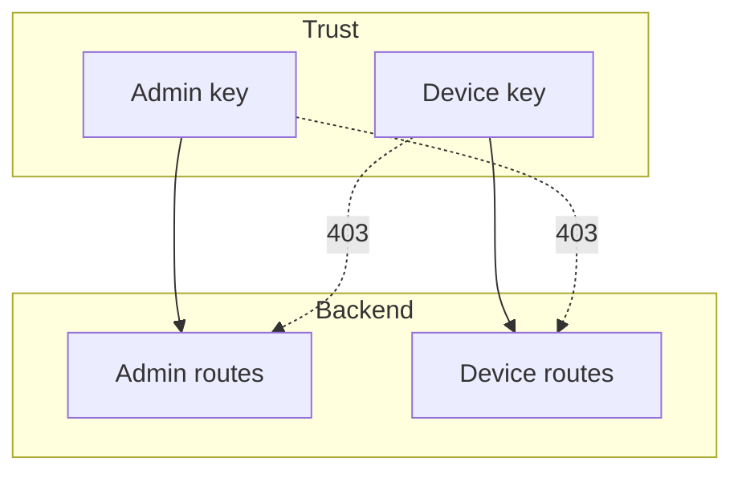

# Security Policy

ElderShield is a **defensive** system for family devices. Please report vulnerabilities privately and do not open public issues that include exploit detail for a private family deployment.

  <a href="README.md">README</a> · <a href="CONTRIBUTING.md">Contributing</a> · <a href="docs/runbooks/admin-api-keys.md">API keys runbook</a>

---

## Supported versions

| Component | Branch / track | Support |
|-----------|----------------|---------|
| Backend + Android Phase 1 | `main` and open fix PRs | Active |
| Debug APK | Local / internal | Cleartext LAN allowed **for debug only** |
| Release APK | When published | Cleartext **disabled**; HTTPS required |

---

## Threat model (summary)

| Asset | Protection |
|-------|------------|
| Admin API | Separate admin `X-API-Key`; device key → **403** on admin routes |
| Device API | Device key only; admin key → **403** on device routes |
| Admin UI session | HMAC cookie (`eldershield_admin_session`) — **not** the raw API key |
| Rule sync | HTTPS in production; monotonic bundle generation |
| Parent privacy | No parent popups; minimize phone-number storage/logging |
| Banking apps | No Overlay / Accessibility / Device Admin; `VpnService` off by default |

---

## Hardening checklist (operators)

| Check | Action |
|-------|--------|
| Keys | Set strong, **distinct** `ADMIN_API_KEY` / `DEVICE_API_KEY` |
| Defaults | Process **refuses** `change-me-*` unless `ELDERSHIELD_ALLOW_INSECURE_DEFAULTS=1` (local only) |
| Transport | Terminate TLS in front of uvicorn; set `COOKIE_SECURE=1` for HTTPS admin UI |
| Network | Do not expose admin UI to the public Internet without authn + TLS |
| Android | Provision device key via installer UI / MDM — never ship release with blank/default keys |
| Debug | Debug cleartext is for LAN lab only — do not distribute debug builds as “production” |

Details: [`docs/runbooks/admin-api-keys.md`](docs/runbooks/admin-api-keys.md)

---

## Reporting a vulnerability

1. **Do not** file a public GitHub issue with exploit steps.  
2. Contact the repository owner (`xzawed`) via a private channel (e.g. GitHub Security Advisory if enabled, or direct message).  
3. Include: affected component (backend/Android), version/commit, impact, and a minimal reproduction.  
4. Allow reasonable time for a fix before any disclosure.

We will acknowledge receipt and coordinate a fix / advisory when applicable.

---

## Out of scope (by product design)

| Item | Note |
|------|------|
| Parent-device “remote wipe” / offensive tooling | Explicitly forbidden |
| Guaranteeing 100% scam-call coverage | Heuristic + rule-based; fail-open if cache empty |
| Shared country calling codes (e.g. `+7`) | Documented limitation — may over-block without finer prefixes |

---

## Security-related tests

| Area | Where |
|------|--------|
| Key separation / 401 / 403 | `backend/tests/test_ut_b_*` |
| Insecure default refusal | `backend/tests/test_secure_settings.py` |
| Admin session cookie | `backend/tests/test_admin_session_cookie.py` |
| Whitelist exact match | `android/core/.../CountryRestrictionMatcherTest` |

Run: `cd backend && pytest -q` · `cd android && ./gradlew :core:test`
