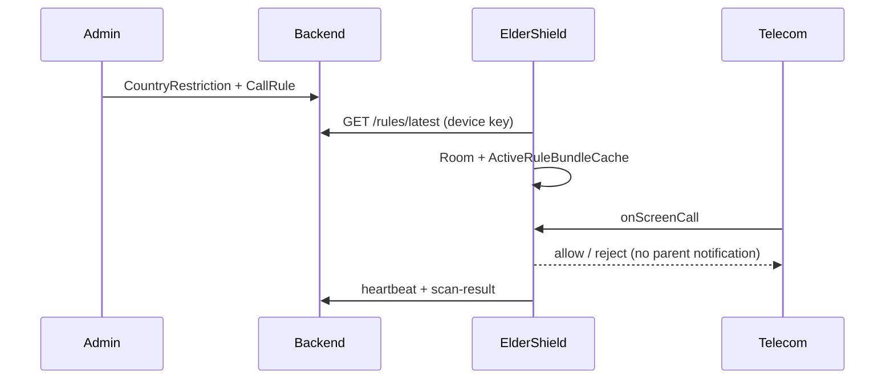

# Real-device test (S6.1)

Pre-flight after automated green (`pytest -q`, `:core:test`, `assembleDebug`).

## Architecture reminder



## 0. Lab network

| Step | Detail |
|------|--------|
| Backend bind | `uvicorn app.main:app --host 0.0.0.0 --port 8000` from `backend/` with `.env` loaded |
| Firewall | Allow TCP 8000 from the phone’s Wi‑Fi LAN |
| Keys | Distinct non-`change-me` `ADMIN_API_KEY` / `DEVICE_API_KEY` |
| Cookie | Leave `COOKIE_SECURE` unset for HTTP lab UI |

## 1. Install debug APK

```bash
cd android
./gradlew :app:assembleDebug
adb install -r app/build/outputs/apk/debug/app-debug.apk
```

Debug APK allows cleartext HTTP. Do **not** use this path for production release testing.

## 2. Provision on device

1. Open **ElderShield** (admin provisioning screen).  
2. Base URL = origin only, e.g. `http://192.168.0.10:8000` (no `/api/v1`).  
3. Device API key = `DEVICE_API_KEY` (not admin).  
4. Tap **Save & sync now**.  
5. Tap **Request call screening role** and accept the system dialog  
   (or `adb shell cmd role add-role-holder android.app.role.CALL_SCREENING com.eldershield`).

## 3. Seed rules

| Action | Expect |
|--------|--------|
| Admin UI login | Session cookie is HMAC, not raw key |
| Create CountryRestriction | `countries` multi-select, `applyTo` includes `call` |
| Optional CallRule | Full E.164 whitelist entries only (prefix like `+86` alone will **not** match) |
| `GET /api/v1/rules/latest` | `version` rose; `countryRestrictions` / `callRules` present |

## 4. Confirm device↔server

| Check | How |
|-------|-----|
| Heartbeat | `GET /api/v1/admin/devices` shows `deviceUuid`, `lastSyncAt`, `lastRuleVersion` |
| DNS flag | `dnsConfigured=true` only for trusted Private DNS hosts (NextDNS/AdGuard) |
| Call role | `callScreeningEnabled=true` after role grant |
| Sync | `lastRuleVersion` matches latest bundle `version` |

If the device list stays empty: battery optimization, wrong key, wrong URL, or backend not reachable — MainActivity status is **not** proof of sync success.

## 5. Call screening smoke

| Case | Expect |
|------|--------|
| Restricted-country test number (e.g. `+86…` with CN restricted) | Rejected; **no** ElderShield parent notification |
| Whitelisted full number | Allowed even if country restricted |
| KR number with only CN/RU restricted | Allowed |
| Empty cache / sync fail | Fail-open (call allowed) |

## 6. Banking-app regression

Install/open bank apps used by parents (e.g. Toss, KakaoBank). Expect normal launch — no Overlay/Accessibility/Device Admin/VpnService from ElderShield.

## 7. Scanner smoke

Sideloaded non-system app with dangerous perms (e.g. `READ_SMS`) → after report worker, admin scan results show `installer` / `dangerousPermissions` / `riskScore`.  
Empty scan list with successful heartbeat ≠ “scanner broken”; score may be below threshold.

## Pass / fail log

| Item | Pass? | Notes |
|------|-------|-------|
| Provision + sync | | |
| Call screening role | | |
| Restricted call blocked | | |
| Whitelist allowed | | |
| Bank apps OK | | |
| Admin devices/scans visible | | |
