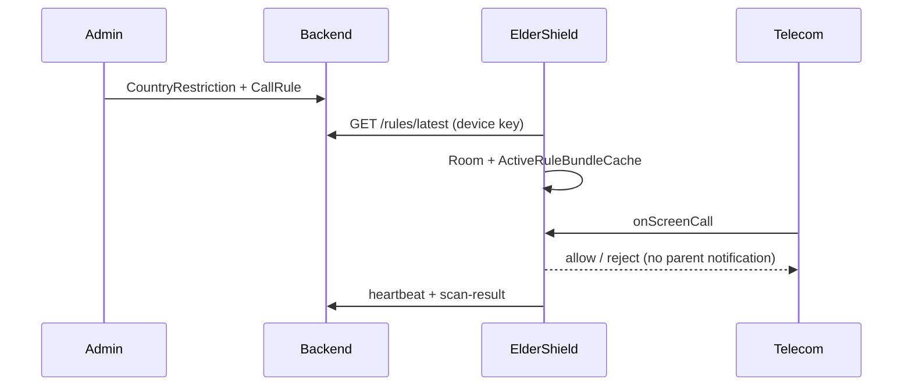

# Real-device test (S6.1)

Pre-flight after automated green (`pytest -q`, `:core:test`, `assembleDebug`).

## Architecture reminder



## 0. Lab network

| Step | Detail |
|------|--------|
| Backend bind | `uvicorn app.main:app --host 0.0.0.0 --port 8000` from `backend/` with `.env` loaded |
| Firewall | Allow TCP 8000 from the phone’s Wi‑Fi LAN |
| Keys | Distinct non-`change-me` `ADMIN_API_KEY` / `DEVICE_API_KEY` |
| Cookie | Leave `COOKIE_SECURE` unset for HTTP lab UI |

## 1. Install debug APK

```bash
cd android
./gradlew :app:assembleDebug
adb install -r app/build/outputs/apk/debug/app-debug.apk
```

Debug APK allows cleartext HTTP. Do **not** use this path for production release testing.

### Emulator lab (optional, pre-device)

| Step | Detail |
|------|--------|
| Backend | `uvicorn … --host 127.0.0.1 --port 8765` (or 8000) with non-`change-me` keys |
| Port forward | `adb reverse tcp:8765 tcp:8765` then Base URL `http://127.0.0.1:8765` |
| Alt host | Without reverse, emulator may use `http://10.0.2.2:8765` |
| Expect | After **Save & sync now**, `GET /api/v1/admin/devices` shows a heartbeat row; WorkManager logs `RuleSyncWorker` / `DeviceReportWorker` **SUCCESS** |

Call screening / bank-app checks still need a real phone (S6.1). Emulator validates provision + sync + heartbeat only.

## 2. Provision on device

1. Open **ElderShield** (admin provisioning screen).  
2. Base URL = origin only, e.g. `http://192.168.0.10:8000` (no `/api/v1`).  
3. Device API key = `DEVICE_API_KEY` (not admin).  
4. Tap **Save & sync now**.  
5. Tap **Request call screening role** only if policy allows (see §8 / SSOT §1.2).  
   **Do not** tell the parent to uninstall or disable Bitdefender — 병행 사용이 하드 목적이다.  
6. Allow **Contacts** (+ Call log / Phone) when prompted.  
   **Android rule:** without `READ_CONTACTS`, numbers already in the address book are **not** passed to `CallScreeningService`.

## 3. Seed rules

| Action | Expect |
|--------|--------|
| Admin UI login | Session cookie is HMAC, not raw key |
| Create CountryRestriction | `countries` multi-select, `applyTo` includes `call` |
| Optional CallRule | Full E.164 whitelist entries only (prefix like `+86` alone will **not** match) |
| `GET /api/v1/rules/latest` | `version` rose; `countryRestrictions` / `callRules` present |

## 4. Confirm device↔server

| Check | How |
|-------|-----|
| Heartbeat | `GET /api/v1/admin/devices` shows `deviceUuid`, `lastSyncAt`, `lastRuleVersion` |
| DNS flag | `dnsConfigured=true` only for trusted Private DNS hosts (NextDNS/AdGuard) |
| Call role | `callScreeningEnabled=true` after role grant |
| Sync | `lastRuleVersion` matches latest bundle `version` |

If the device list stays empty: battery optimization, wrong key, wrong URL, or backend not reachable — MainActivity status is **not** proof of sync success.

## 5. Call screening smoke

| Case | Expect |
|------|--------|
| Restricted-country test number (e.g. `+86…` with CN restricted) | Rejected; **no** ElderShield parent notification |
| Whitelisted full number | Allowed even if country restricted |
| KR number with only CN/RU restricted | Allowed |
| With **KR** restricted: domestic **incoming** `010…` (not whitelist) | Rejected (national trunk `0` → `82` normalization) |
| Outgoing dial ("걸기") | Not screened — CallScreening is **incoming only** |
| Empty cache / sync fail | Fail-open (call allowed) |

## 6. Banking-app regression

Install/open bank apps used by parents (e.g. Toss, KakaoBank). Expect normal launch — no Overlay/Accessibility/Device Admin/VpnService from ElderShield.

## 7. Scanner smoke

Sideloaded non-system app with dangerous perms (e.g. `READ_SMS`) → after report worker, admin scan results show `installer` / `dangerousPermissions` / `riskScore`.  
Empty scan list with successful heartbeat ≠ “scanner broken”; score may be below threshold.

## 8. KR-lab constraint matrix (Korea location, KR handset only)

CN/RU **PSTN SIM is unavailable**. Split coverage:

| ID | Case | Where | How | Pass criteria |
|----|------|-------|-----|---------------|
| L1 | Backend unit + denylist shape | Host | `pytest -q`; `GET …/dns-denylist` | green; `tlds` includes seeded countries |
| L2 | NextDNS auto-push | Host | `POST …/sync-nextdns` | 200 when `NEXTDNS_*` set; else **SKIP** (503 expected) |
| L3 | Provision + reverse + heartbeat | Emulator **and** S22 USB | `adb reverse`; Save & sync | `lastRuleVersion` = bundle `version`; role true |
| L4 | CN incoming block | **Emulator only** | `adb emu gsm call +8613999…` (not on whitelist) | Telecom `Reject` / `INCOMING_REJECTED` |
| L5 | CN whitelist allow | Emulator | `adb emu gsm call` exact whitelist E.164 | `Allow` / keeps RINGING |
| L6 | KR `+82` incoming block | Emulator | `adb emu gsm call +8210…` with KR `applyTo:call` | `Reject` |
| L7 | KR national `010` block | **Emulator required**; S22 optional manual | Emu: `gsm call 010…`. S22: only if operator uses a **second own KR phone** (no script auto-dial) | `Reject` (normalize `0`→`82`) |
| L8 | US/other allow control | Emulator | `adb emu gsm call +1…` | `Allow` |
| L9 | Outgoing not country-blocked | **Emulator only** (canonical) | AVD `ACTION.CALL` / combinatorial B-out* / E1–E2. **Do not** auto-dial on S22; no `+86` on physical SIM | `block=false` / dir=OUTGOING Allow (§6.1) |
| L10 | Bank app launch | S22 | `am start` Toss/KakaoBank (if installed) | Activity starts; no ElderShield overlay |
| L11 | Private DNS / internet path | S22 | Settings Private DNS → trusted NextDNS host | heartbeat `dnsConfigured=true`; real `.cn` block needs NextDNS profile (**L2**) |
| E0 | Set AVD own line to CN | Emulator | `adb emu phonenumber 8613…` (**no** `+` prefix) | Console `OK` (not a block trigger by itself) |
| E1 | Own=CN, dial KR service | Emulator | After E0: `am start … CALL tel:114` **on AVD only** | Allow / ACTIVE (own MSISDN ≠ match key) |
| E2 | Dial CN destination | Emulator | `CALL tel:+8613…` with CN restricted **on AVD only** | **Allow** (outgoing; §6.1) |
| E3 | Inbound CN CLI | Emulator | `adb emu gsm call +8613…` | **Reject** (canonical country block) |

**Call safety (lab):**
- `emu gsm call` / AVD `ACTION.CALL` = OK (no PSTN).
- Physical handset: scripts must **not** issue `ACTION.CALL` or inject GSM. Use `ACTION.DIAL` (dialer UI only) or skip.
- Optional human checks on S22: short call to a **known own** second line only — never scripted `+86` / public service numbers.
- After any KR `applyTo:call` lab, restore KR call **disabled** so family `010` is not blocked in daily use.

**Logic note (lab):** “한국에 CN SIM 없음” ≠ “외국 발신자 CLI 재현 불가”. AVD는 `phonenumber`(내 번호) + `gsm call`(수신 CLI)로 재현한다. 내 번호를 외국으로 바꾼 뒤 **걸기**가 되는 것은 정상(발신·또는 목적지가 비제한). 차단 검증의 SSOT 기준은 **E3 수신**이다.

**Do not** treat “cannot get a CN SIM in Korea” as a product fail — L4/L5/E0–E3 cover CN on AVD.

| ID | Case | Where | Constraint |
|----|------|-------|------------|
| L12 | Bitdefender 병행 | S22 | Bitdefender **유지**. ElderShield must not instruct to turn off BD. Platform: only **one** `ROLE_CALL_SCREENING` holder — if BD holds it, ElderShield call-path cannot receive `onScreenCall`; report role holder to admin, keep DNS/scan paths. **Never** `cmd role add-role-holder` steal in lab without explicit test of “role already free”. |

Repeatable host scripts:
- `scripts/lab-batch-verify.ps1` — emulator + USB S22 + API (L1–L11); S22 L9 = SKIP (no auto CALL)
- `scripts/lab-s22-uiautomation.ps1` — USB UIAutomator (sync, DNS→`dnsConfigured`, **DIAL-only** outgoing UI, bank monkey); call place = AVD
- `scripts/lab-combinatorial-matrix.ps1` — call×DNS×app matrix; gsm/`ACTION.CALL` hard-gated to `emulator-*`

## Pass / fail log

| Item | Pass? | Notes |
|------|-------|-------|
| Provision + sync | | |
| Call screening role | | |
| Restricted call blocked | | |
| Whitelist allowed | | |
| Bank apps OK | | |
| Admin devices/scans visible | | |
| L1–L11 KR-lab matrix | | See §8 |
