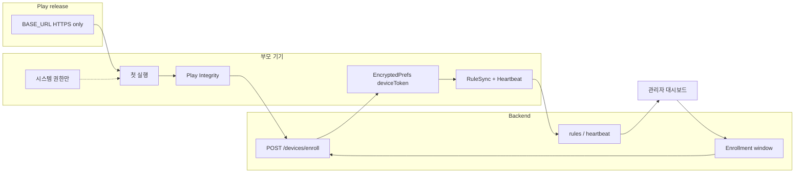

# Zero-touch 설치·등록 설계 (부모님 입력 제로 + 키 RE 내성)

**Version**: 1.0  
**작성일**: 2026-11-20  
**지위**: Phase 1 SSOT ([`2026-11-18-eldershield-system-design.md`](2026-11-18-eldershield-system-design.md)) **addendum**  
**승인**: 대화 브레인스토밍 섹션 1–4 (설치 주체 C · 원격 채널 C 수정 → Integrity+기기토큰 · UX/API/롤아웃)

---

## 1. 확정 결정

| 항목 | 선택 |
|------|------|
| 설치 주체 | **C**: 관리자 동석 + 부모님 원격 Play 설치 **둘 다** |
| 부모님 입력 | URL·API 키·초대 코드·QR **없음** |
| APK에 장기 `DEVICE_API_KEY` | **금지** (리버싱 유출 방지) |
| Release에 넣는 것 | HTTPS `BASE_URL` 만 |
| 등록 | Play Integrity + 관리자 **등록 창(enrollment window)** + **기기별 토큰** |
| 토큰 저장 | EncryptedSharedPreferences / Android Keystore |
| 초대 링크·QR·MDM | **비범위** |
| CallScreening | §1.2.1 유지 (강탈·BD 끄기 지시 금지) |

### 1.1 하드 제약 (상속)

- 부모님 불편 제로 · 무인지 규칙 반영
- Overlay / Accessibility / Device Admin **ElderShield 사용 금지**
- VpnService 기본 비활성
- `countries`는 항상 배열
- 합법적 방어만 · 전화번호 원문 최소화

### 1.2 플랫폼 한계 (명시)

소비자 Android에서 연락처·CallScreening 등 **시스템 권한/역할 다이얼로그는 최소 1회 필요**.  
목표는 “입력·설정 화면 제로”이지 “OS 동의 팝업 제로”가 아니다.  
Private DNS는 앱이 대신 설정하지 않음 (기존 SSOT · 관리자 안내).

---

## 2. 목표·성공 기준

| ID | 기준 |
|----|------|
| S1 | 원격: Play Internal 설치 → 권한만 허용 → Devices에 heartbeat (키/URL 입력 0) |
| S2 | 동석: 동일 + 필요 시 관리자 숨김 화면에서 CallScreening만 처리 |
| S3 | Release APK/AAB 문자열에 장기 device/family API key **없음** |
| S4 | 등록 창 OFF → `enroll` 거부 |
| S5 | Bitdefender 등 peer 보유 시 자동 역할 요청 안 함 |
| S6 | 기기 토큰 폐기 시 해당 기기만 sync/heartbeat 실패 · 타 기기 무영향 |

---

## 3. 아키텍처

### 3.1 런타임 순서

1. Application/첫 Activity: EncryptedPrefs에 `deviceToken` 없으면 enroll 시도  
2. Play Integrity 토큰 획득 → `POST /api/v1/devices/enroll`  
3. 성공 시 `deviceUuid` + `deviceToken` 저장 → RuleSync + DeviceReport 즉시 enqueue  
4. 미허용 런타임 권한만 시스템 다이얼로그 (Contacts / Call log / Phone)  
5. CallScreening: peer 있으면 자동 요청 **금지**; 역할 비어 있고 peer 없을 때만 자동 요청 허용(구현 시 SSOT §1.2.1과 동일 프로브)  
6. 부모님 UI: 입력 폼·운영 상태 대시보드 없음. 권한 후 종료 가능

### 3.2 빌드 변형

| Variant | 프로비저닝 |
|---------|------------|
| `debug` | 기존 MainActivity URL/키 수동 입력 유지 (랩 · adb reverse) |
| `release` (Play) | `BuildConfig.BASE_URL` only · enroll 필수 · 공유 `DEVICE_API_KEY` 미포함 |

CI/`local.properties`(gitignore)에서만 `BASE_URL` 주입. 키·토큰 시크릿을 git에 커밋하지 않음.

### 3.3 관리자 동석 경로

동일 release 빌드. 숨김 진입(길게 누르기 / 디버그 제스처 / 별도 debug 전용 아님 시 제한적)으로 CallScreening 수동 요청·역할/peer 상태 확인.  
랩 전용 공유키 UI는 **debug에만**.

---

## 4. 보안

### 4.1 위협 모델 (요약)

| 위협 | 완화 |
|------|------|
| APK 문자열에서 가족 API 키 추출 | 장기 키를 바이너리에 넣지 않음 |
| 탈취한 enroll로 무한 가짜 기기 | 등록 창 OFF · rate limit · 관리자 “새 기기” 알림 · Integrity 실패 거부 |
| 정상 기기 토큰 유출 | 기기별 토큰 · 관리자 폐기 · 선택적 회전 |
| MITM | HTTPS 필수 · release 인증서 핀닝(권장) |
| 난독화만 의존 | **주 방어 아님** — R8은 보조 |

완벽한 클라이언트 비밀은 Android에서 보장 불가. 목표는 **바이너리 추출만으로 장기간 API 도용 불가**.

### 4.2 Play Integrity

- release enroll에 Integrity 토큰 필수 (랩/emulator는 debug 경로 또는 테스트 우회 플래그 — 프로덕션 기본 OFF)
- 서버는 Google 검증 후 `MEETS_DEVICE_INTEGRITY`(또는 프로젝트 정책에 맞는 verdict)만 수용
- 세부 verdict 임계값은 구현 계획에서 확정 · Internal 테스트 실측 후 조정 가능

### 4.3 등록 창 (부모 입력 없이 원격 지원)

- 관리자: `등록 허용` ON + TTL(기본 예: 30분)  
- 창이 열린 동안에만 enroll 성공  
- 창당 상한(`ENROLL_MAX_PER_WINDOW`) · IP rate limit · Integrity 토큰 재사용 거부  
- `ELDERSHIELD_ENROLL_SKIP_INTEGRITY` 는 `ALLOW_INSECURE_DEFAULTS=1` 없이는 기동 거부  
- 부모님에게 링크/코드를 보내지 않음 — **설치 타이밍만** 관리자가 맞춤 (전화 안내: “지금 Play에서 설치·허용만”)

### 4.4 기기 토큰 ↔ UUID 바인딩

- Per-device 토큰으로 인증된 요청은 body `deviceUuid`가 **발급 기기와 일치**해야 함 (`device_uuid_mismatch` 거부).  
- 공유 랩 `DEVICE_API_KEY`만 임의 UUID heartbeat 허용 (debug).

---

## 5. API (요지)

Base: `/api/v1`. 인증 헤더 별칭은 기존 `X-API-Key` 유지하되, release 기기는 **기기 토큰** 값을 넣는다.

| Method | Path | Auth | 역할 |
|--------|------|------|------|
| `POST` | `/devices/enroll` | 없음(또는 앱 attestation body만) | Integrity + 등록 창 → `{ deviceUuid, deviceToken }` |
| `GET` | `/rules/latest` | 기기 토큰 | 기존과 동일 |
| `POST` | `/devices/heartbeat` | 기기 토큰 | 기존 + Phase 2 health |
| `POST` | `/devices/apps/scan-result` | 기기 토큰 | 기존 |
| `POST` | `/admin/enrollment-window` | 관리자 | `{ enabled, expiresAt }` 설정 |
| `GET` | `/admin/enrollment-window` | 관리자 | 현재 창 상태 |
| `DELETE` | `/admin/devices/{deviceUuid}/token` | 관리자 | 해당 기기 토큰 폐기(재-enroll 필요) |

### 5.1 마이그레이션

- 공유 `DEVICE_API_KEY`: **debug·마이그레이션 기간** 서버에서 계속 수용 가능  
- Play release 경로: enroll 없이 공유 키로 장기 운영하지 않음  
- 기존 랩 기기 행은 유지 · 신규 release 기기는 새 UUID+토큰

요청/응답 JSON 스키마·오류 코드는 구현 계획에서 OpenAPI/테스트로 고정.

---

## 6. Android UX

| 대상 | UI |
|------|-----|
| 부모님 | 런타임 권한 시스템 UI만. 설정 폼·토스트 남발 금지 |
| 관리자 숨김 | CallScreening 요청 버튼 · peer/role 텍스트(기존 MainActivity 축소판) |
| 알림 | 부모님 대상 ElderShield 알림 채널 추가 금지 (기존 SSOT) |

---

## 7. 롤아웃

1. Backend: enroll · enrollment-window · per-device token · admin revoke  
2. Android: release autoprovision · Integrity · EncryptedPrefs · 부모님 입력 UI 제거/가림  
3. Play Internal AAB 재업로드  
4. 실측: S22 L3 heartbeat · 등록 창 OFF 거부 · BD peer 시 자동 역할 요청 없음  
5. Runbook: `play-internal.md` / `device-test.md`에 “설치 전 등록 창 ON” 한 줄  
6. 초대 링크·QR·MDM은 후속 스펙

---

## 8. 비범위

- 기기별 초대 토큰 / QR / 딥링크 enrollment  
- MDM / Managed Google Play 구성 프로파일  
- Private DNS 자동 설정  
- CallScreening 역할 강제 강탈  
- 다테넌트·조직 RBAC (Phase B)

---

## 9. 문서·SSOT 관계

- 본 문서는 addendum이다. 충돌 시 **하드 제약·§1.2.1** 은 Phase 1 SSOT가 우선.  
- 구현 착수 전: 본 스펙 사용자 리뷰 → `writing-plans`로 구현 계획 → Backend→Android 순.

---

## 10. 셀프 리뷰 (작성 시)

| 검사 | 결과 |
|------|------|
| 플레이스홀더 / TBD 남김 | 없음 (Integrity verdict 세부는 §4.2에서 “구현 계획에서 확정”으로 명시) |
| 섹션 1–4 승인 내용과 모순 | 없음 — 고정키 APK는 폐기, Integrity+창+기기토큰으로 대체 |
| 부모님 입력 제로 vs 등록 창 | 양립 — 입력은 관리자 대시보드만 |
| 범위 비대화 | 링크/QR/MDM 비범위 유지 |
